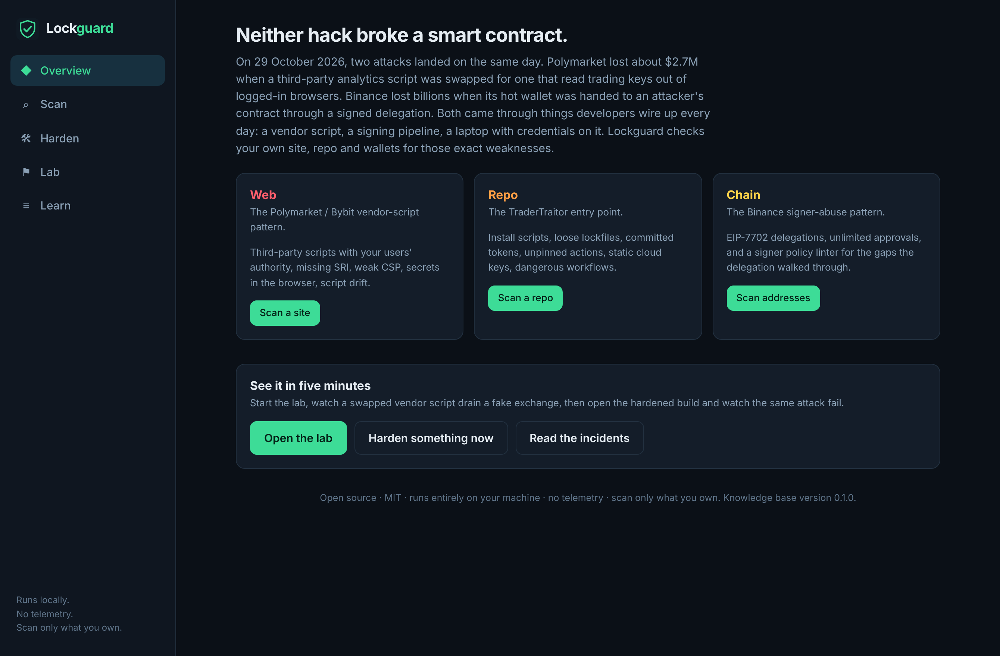
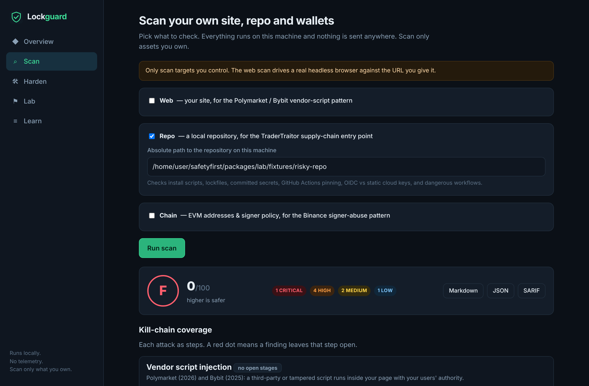
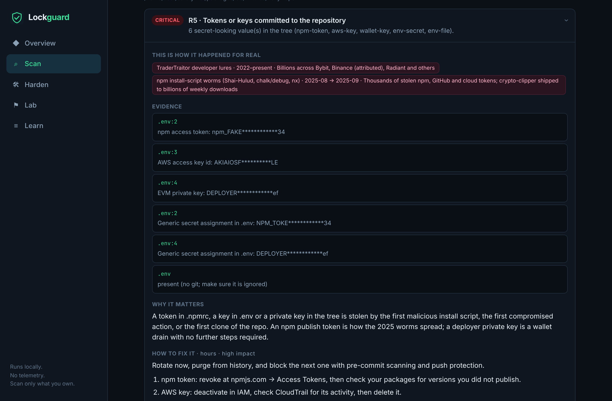
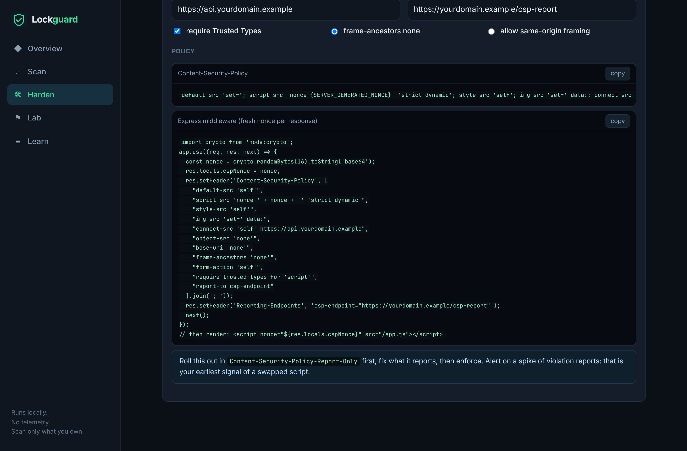
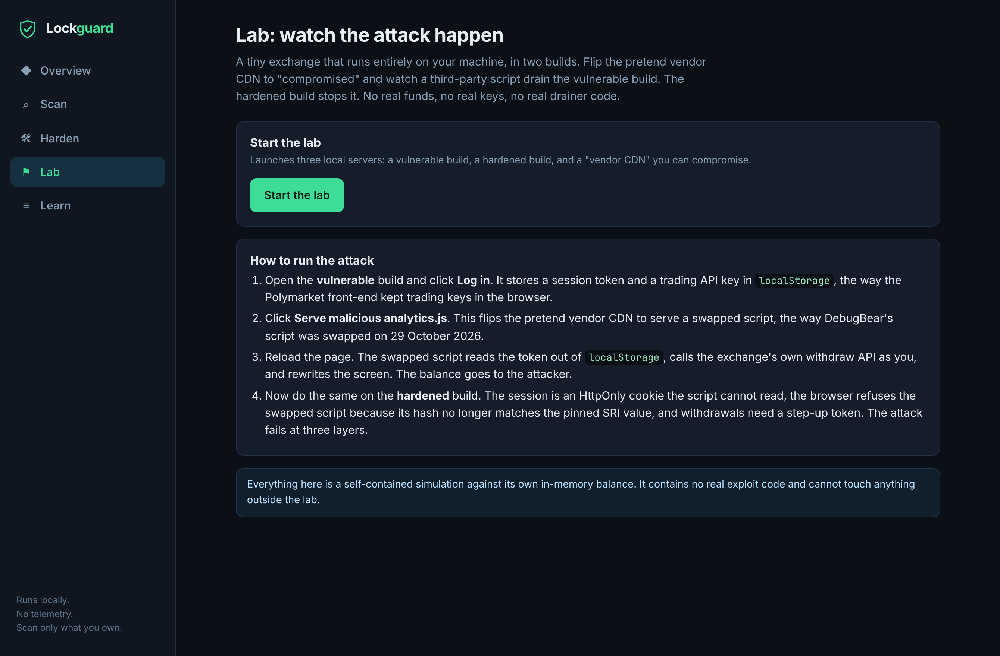

<div align="center">

# Lockguard

**See the exact weaknesses behind the Polymarket, Binance and Bybit attacks — in your own site, repo and wallets.**

Open source · MIT · runs entirely on your machine · no telemetry



</div>

---

On **29 October 2026**, two attacks landed on the same day.

- **Polymarket** lost about **$2.7M** when a third-party analytics script (from the performance vendor DebugBear) was swapped for code that read trading API keys out of logged-in browsers.
- **Binance** lost **billions** when its hot wallet "Binance 14" was handed to an attacker's contract through a signed **EIP-7702 delegation**.

Eight months earlier, **Bybit** lost **$1.5B** when a Safe{Wallet} developer's machine was compromised and planted JavaScript rewrote what Bybit's signers saw.

**Neither of the October hacks broke a smart contract.** Both came through things developers wire up every day: a vendor script, a signing pipeline, a laptop with credentials on it. Lockguard checks your own stack for those exact weaknesses, shows you the real incident each finding maps to, and hands you the fix.

## What it is

A **local web app** (plus a CLI and a hands-on lab) with three scanners:

| Module | Attack it maps to | What it checks |
|---|---|---|
| **Web** | Polymarket / Bybit vendor-script injection | Third-party scripts running with your users' authority, missing Subresource Integrity, weak or missing CSP, session tokens and API keys readable by JavaScript, Trusted Types, and script-hash **drift** against an approved baseline |
| **Repo** | TraderTraitor developer / CI compromise | Dependency install scripts, lockfile discipline, committed tokens and keys, GitHub Actions pinned by tag instead of SHA, static cloud keys vs OIDC, and dangerous workflow triggers |
| **Chain** | Binance signer-infrastructure abuse | EIP-7702 delegations on your addresses, unlimited token approvals, and a **signer policy linter** for the gaps the Binance delegation walked through |

Every finding is scored, grouped by **kill chain**, mapped to the **real incident**, and paired with a **hands-on fix** (copy-paste CSP, SRI tags, pinned workflows, revoke calldata, a signer policy).

## How it helps

Most security tools give you a flat list of alerts and leave you to figure out whether any of it matters. Lockguard is built around a different idea: **you only act on a weakness once you understand the attack it enables and can see the fix.**

- **It finds the weaknesses that actually got people robbed**, not a generic checklist. Every check traces to a real 2025–2026 incident where that exact gap was the way in.
- **It tells you why each finding matters, in plain terms**, with the real incident attached — so a developer can judge severity for their own app instead of trusting a number.
- **It hands you the fix, ready to paste** — a strict CSP, an SRI tag, a SHA-pinned workflow, revoke calldata, a signer policy — so "you have a problem" and "here's how to close it" are the same screen.
- **It groups findings by kill chain**, so you see *"this is the step where Polymarket happened to you,"* and which defense would have stopped it, rather than isolated line items.
- **It lets you watch the attack happen** in a local lab, then watch the same attack fail in a hardened build — the fastest way to understand why the fix works.
- **It runs anywhere your code and wallets are**, entirely offline, with no account and no data leaving your machine — so you can point it at production config and real addresses without hesitation.
- **It drops into CI** with SARIF output and a `--fail-on` gate, so a regression (a new unpinned action, a committed key, a dropped CSP) breaks the build instead of shipping.

**Who it's for:** developers and security teams at exchanges, wallets, dApps and any web app that moves money or holds sessions worth stealing — and anyone who wants to understand how the 2026 hacks actually worked.

## Quick start

```bash
git clone https://github.com/Yathish27/Lockguard lockguard
cd lockguard
npm install
npm run build
npm start          # opens the UI at http://localhost:4477
```

Then:

1. **Lab** → *Start the lab* → open the vulnerable build, log in, serve the malicious `analytics.js`, reload, and watch a third-party script drain the demo balance. Open the hardened build and watch the same attack fail.
2. **Scan** → point the web module at the vulnerable lab build (or your own site), or the repo module at a local repository, or the chain module at your addresses.
3. **Harden** → generate a strict CSP, hash a script for SRI, pin your GitHub Actions to commit SHAs, lint a signer policy, or build revoke calldata.

## A look inside

**Scan anything you own, get a score and a kill-chain map.** Pick the web, repo and/or chain module. Findings are scored A–F and exportable as Markdown, JSON or SARIF.



**Every finding maps to a real incident, explains why it matters, and ships the fix.** Here a repo scan found committed secrets (R5) and ties it to the TraderTraitor developer lures and the 2025 npm worms, with masked evidence and step-by-step remediation.



**Turn findings into fixes in the Harden tab** — a strict CSP builder, an SRI generator, a GitHub Actions SHA-pinner, a signer-policy linter, and approval-revoke calldata.



**Watch the attack happen, then watch it fail.** The lab runs a vulnerable and a hardened build of a toy exchange plus a "vendor CDN" you can compromise — no real funds, keys or exploit code.



### CLI

```bash
npx lockguard ui                                   # the UI (same as npm start)
npx lockguard scan --repo .                        # scan a repository
npx lockguard scan --web https://app.example.com/trade --signing-page
npx lockguard scan --chain 0xYourAddress --network mainnet
npx lockguard scan --repo . --fail-on high --sarif out.sarif   # for CI
```

### In CI (GitHub Actions)

```yaml
- uses: Yathish27/Lockguard@main
  with:
    repo: .
    web: https://app.example.com/trade
    fail-on: high
```

Findings upload to GitHub code scanning as SARIF.

### Run it hosted (Firebase)

Lockguard also deploys to Firebase as a shared web app: **Firebase Hosting** serves the UI and **Cloud Run** runs the API (with Chromium) for the web and chain scanners and the Harden tools. The hosted build runs in `LOCKGUARD_HOSTED=1` mode, which blocks SSRF (web targets must be public) and hides the repo scanner and the lab, since both are inherently local. See [`DEPLOY.md`](DEPLOY.md) for the full setup; the short version:

```bash
npm ci && npm run build
gcloud run deploy lockguard-api --source . --region us-central1 \
  --allow-unauthenticated --memory 2Gi --cpu 2 \
  --min-instances 1 --max-instances 1 --no-cpu-throttling \
  --set-env-vars LOCKGUARD_HOSTED=1
firebase deploy --only hosting
```

## The lab

A tiny exchange that runs entirely on your machine, in two builds, plus a pretend "vendor CDN" you can compromise.

- **Vulnerable build** keeps the session token and a trading API key in `localStorage`, loads a cross-origin vendor script with no SRI and no CSP. Flip the vendor to malicious, reload, and the swapped script reads the token and drains the balance — the Polymarket pattern.
- **Hardened build** keeps the session in an `HttpOnly` cookie, ships a strict nonce-based CSP, pins the vendor script with a real SRI hash, and requires step-up auth for withdrawals. The swapped script fails the integrity check and never runs; even if it did, it could not read the cookie or mint the step-up token.

**There are no real funds, no real keys, and no real drainer code anywhere.** The simulation only ever touches the lab's own in-memory balance.

## Guardrails on the tool itself

- Passive, unauthenticated checks by default. Authenticated web scans use **your own** exported browser session.
- **No exploitation.** The lab only ever attacks itself.
- **Nothing leaves your machine.** No network calls except the ones you ask for (the URL you scan, the RPC you choose, GitHub's API when you pin actions). No telemetry.
- A clear **"scan only what you own"** notice throughout.

## How it is built

A TypeScript monorepo:

- `packages/core` — the scanner engines, knowledge base (incidents, kill chains, rules), report formats (JSON / Markdown / SARIF), and the hardening tools. No UI or server dependencies.
- `packages/server` — an Express API and the CLI; serves the built UI.
- `packages/ui` — a React + Vite single-page app.
- `packages/lab` — the vulnerable/hardened exchange and the vendor CDN.

```bash
npm run dev     # hot-reloading UI at :5173, API at :4477
npm test        # unit tests for the engines
```

See [`docs/blog.md`](docs/blog.md) for the story, [`docs/signer-policy.md`](docs/signer-policy.md) for the policy schema, and [`CONTRIBUTING.md`](CONTRIBUTING.md) to add a check.

## License

MIT. Incident figures are from public reporting at the time of writing and are cited in [`docs/incidents.md`](docs/incidents.md); where sources disagree, the knowledge base says so.
