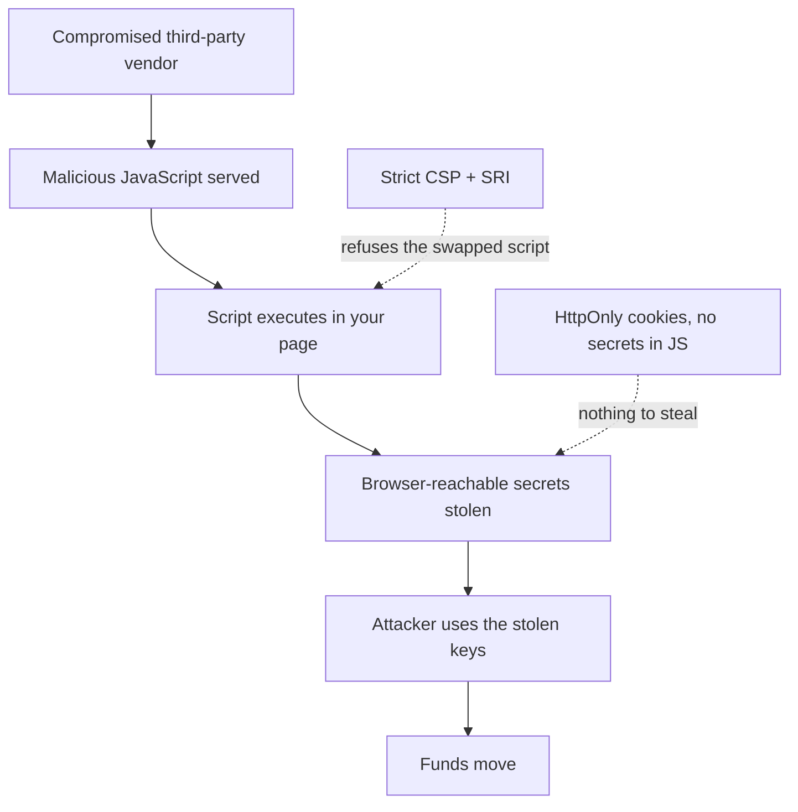
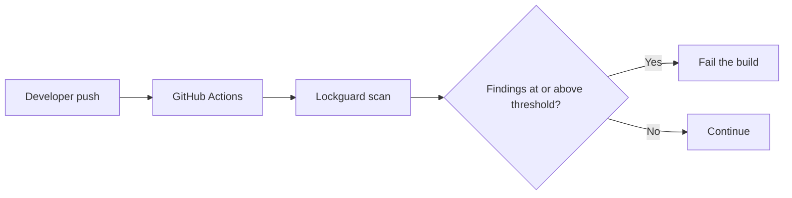
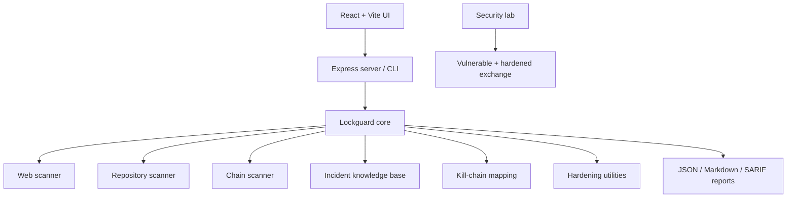

# Two crypto hacks in one day took billions. Neither one broke a smart contract.

### So I built Lockguard — an open-source scanner that finds the exact weaknesses behind the Polymarket, Binance and Bybit attacks in your own site, code and wallets, and hands you the fix.

**By Yathish**

> 🔗 [Lockguard on GitHub](https://github.com/Yathish27/Lockguard) · 🌐 [Live app](https://lockguard-9b9b2.web.app/)

<escape>[IMAGE 1 — Cover image: the Lockguard hero / cybersecurity cover. Use as the Medium cover.]</escape>

---

On **29 October 2026**, two of the largest thefts in crypto history landed on the same day.

Polymarket lost about **$2.7 million**. Binance lost billions — its own estimate put the damage around **$6.3 billion**. Different platforms, different chains, different attackers' end goals.

And here's the part that should keep every builder up at night: **neither one broke a smart contract.**

No reentrancy bug. No integer overflow. No flawed upgrade. The contracts did exactly what they were written to do. The attackers never touched them. They walked in through the plumbing *around* the code — the stuff every team wires up on an ordinary Tuesday and never thinks about again.

That realization is what made me build **Lockguard**: a tool that checks your own website, your code, and your wallets for those exact weak spots — and, for each one it finds, shows you the real attack it maps to, explains why it matters in plain language, and gives you a fix you can paste in.

Let me walk you through what actually happened, and what I built in response.

---

## Part 1 — What actually happened

### Polymarket: a third-party script turned on its users

Modern web apps are stitched together from other people's JavaScript — analytics, performance monitors, chat widgets, tag managers. It's normal. It's also a trust boundary most teams forget they have.

A script you load from someone else's server runs with the *full authority of your own page*. It can read anything your own code can read: `localStorage`, cookies that aren't locked down, the DOM, your API responses.

On 29 October, the analytics script Polymarket loaded from an outside vendor was swapped for a malicious version. Running inside polymarket.com with first-party power, it read the trading API keys the site kept in users' logged-in browsers and used them to move funds. Polymarket pulled the script within the hour, reset every session, and refunded users — but the money was already gone.

The lesson isn't "that vendor got unlucky." It's this:

> **A third-party script is first-party code. Its next deploy — or its next breach — runs in your users' browsers.**

A simple tag like this is a standing invitation:

```html
<script src="https://analytics.example.com/analytics.js"></script>
```

The browser can't tell the original file from a tampered one unless you give it a way to check. That's what Subresource Integrity, a strict Content Security Policy, and keeping secrets out of JavaScript's reach are for — and exactly what Lockguard's web scanner looks for.

### Binance: a valid signature for a transaction that should never have been signed

Blockchain security has always obsessed over contract code. But the wallet infrastructure that *authorizes* transactions matters just as much.

The wallet at the center of the Binance incident — "Binance 14" — was handed to attacker-controlled code through an **EIP-7702 delegation**. EIP-7702 (shipped with Ethereum's Pectra upgrade) lets an ordinary account delegate its execution to a contract. Useful feature. Dangerous when abused: one transaction carrying 50 signed authorizations put the hot wallet under a "sweeper" contract, and it was emptied.

Here's the uncomfortable detail: Binance said **no private key leaked**. The signing *system* produced a genuine signature for a transaction it should have refused. Its co-CEO said the delegation "did not pass through our normal approval controls."

> **A valid signature does not mean a safe transaction.** Wallet security is about *what* gets authorized, *which* code receives authority, and *how long* that authority lasts.

That's what Lockguard's chain scanner checks for.

### The precedent: Bybit, eight months earlier

If this felt familiar, it's because it had already happened at scale. In February 2025, Bybit lost about **$1.5 billion** when a Safe{Wallet} developer's machine was compromised and planted JavaScript rewrote what the signers *saw*. The screen showed a routine transfer; the transaction they actually signed swapped the wallet's implementation. The FBI attributed it to North Korea's TraderTraitor.

Three incidents, one shape: **the system did exactly what it was told — by someone who should never have been able to tell it.**

*(Figures above are from public reporting at the time of writing; where sources disagree, especially on the Binance total, Lockguard's knowledge base says so and cites its sources.)*

---

## Part 2 — What Lockguard is

Lockguard is an open-source security scanner built on one principle:

> **A finding is only useful if it explains the attack, shows why it matters, and gives you a way to fix it.**

Most scanners hand you a severity score and a one-line description. But a developer staring at a report actually needs to know: *What could an attacker really do? Which line is the problem? What real incident proves it? Which control would stop it? How do I verify the fix?*

Lockguard answers those questions for every finding, through three scanners, an incident knowledge base, kill-chain mapping, and a set of hands-on hardening tools. It's MIT-licensed, runs entirely on your machine, and ships as a local web app, a CLI, a GitHub Action, and a hands-on security lab.

<escape>[IMAGE 2 — Screenshot of the Lockguard landing page or the Scan tab showing Web / Repo / Chain. Caption: "One interface for web, repository and blockchain security checks."]</escape>

---

## Part 3 — The three scanners

### A. Web scanner — the Polymarket / Bybit pattern

It drives a **real headless browser** to your URL and inspects what actually loads. No guessing from a template — it reads the live DOM, scripts, response headers, cookies and storage. It checks:

- **Content Security Policy** — is there one, and is it actually strict? A policy with `unsafe-inline` or wildcards is decoration.
- **Subresource Integrity** — does every external script carry a hash the browser can verify?
- **Secrets reachable by JavaScript** — tokens or API keys in `localStorage`, cookies without `HttpOnly`. This is exactly what the Polymarket script stole.
- **Trusted Types** — closing off DOM-based injection sinks.
- **Script-hash drift** — comparing today's scripts to a baseline you approved, so a silent vendor swap pages you in minutes, not hours.

**Subresource Integrity** is the single control that would have turned Polymarket into a broken widget instead of a theft:

```html
<script
  src="https://cdn.example.com/library.js"
  integrity="sha384-EXPECTED_HASH"
  crossorigin="anonymous"></script>
```

If the file changes and the hash no longer matches, the browser refuses to run it. Lockguard's Harden tab generates these for you from the file as it's actually served.

### B. Repository scanner — the developer-and-CI entry point

A perfectly secure app can still be owned during development. Dependencies, build systems, CI workflows and developer credentials are all part of your attack surface — and the way into Bybit, and (per Binance) into Binance. The repo scanner reads your real files and flags:

- **Install scripts** — dependencies that run code the moment you `npm install`. This is the classic "take-home coding test" entry point.
- **Lockfile discipline** — missing lockfiles or loose version ranges that let a build pull last night's poisoned release.
- **Committed secrets** — API keys, tokens and private keys sitting in source control.
- **Actions pinned to tags, not commits** — a tag like `@v4` is a pointer someone can move.
- **Long-lived cloud keys** where short-lived OIDC credentials belong.
- **Dangerous workflow triggers** that expose your secrets to anyone who opens a pull request.

Pinning a GitHub Action is a one-line fix that closes a real supply-chain hole:

```yaml
# a tag someone can quietly repoint:
- uses: actions/checkout@v4

# a commit SHA they can't:
- uses: actions/checkout@<FULL_COMMIT_SHA>  # v4.2.2
```

Lockguard's Harden tab will rewrite a whole workflow this way for you.

### C. Chain scanner — the Binance signer-abuse pattern

Read-only, and it never asks for a key or a signature. It checks:

- **EIP-7702 delegations** — it reads `eth_getCode` for each address you list and flags any that's been handed to contract code. If you didn't install that delegation, it's treated as critical.
- **Unlimited token approvals** — approvals you granted long ago that a compromised spender can still drain. It even generates the revoke calldata.
- **Signer policy** — a linter for the gaps the Binance delegation walked through: a signer that will approve a type-4 delegation, a missing destination allowlist, no velocity caps, single-person policy changes.

The point is to catch the "a valid signature isn't a safe transaction" problem *before* it costs you.

---

## Part 4 — Findings are mapped to attack chains, not dumped as a list

The most important design decision was to stop treating findings as isolated alerts and instead map them to the **kill chain** — the sequence of steps an attacker follows, and the control that breaks each one.

<escape>[IMAGE 3 — Export this Mermaid diagram as an image for Medium.]</escape>



Now a finding reads as *"this is the step where Polymarket happened to you, and here's the defense that would have stopped it"* — not a severity number floating in a spreadsheet. SRI breaks the script-execution step. CSP restricts where a script can send data. HttpOnly cookies empty out the step where secrets get read. Each control kills a different link in the chain.

---

## Part 5 — From detection to fix: the Harden module

Finding a problem is the easy half. Lockguard's **Harden** tab turns each finding into something you can apply:

- **CSP Builder** — generates a strict, nonce-based Content Security Policy.
- **SRI Generator** — hashes a script as served and hands you the ready `<script>` tag.
- **Action Pinner** — rewrites `uses:` tags to commit SHAs.
- **Signer Policy Linter** — reviews your wallet authorization rules.
- **Revoke Calldata** — builds the transaction to drop a dangerous approval.

<escape>[IMAGE 4 — Screenshot of the Harden tab. Caption: "The Harden module turns a finding into a paste-ready fix."]</escape>

So instead of "you have no CSP," you get a CSP to review and adapt. (Always test generated config against your app's real needs — security settings are never one-size-fits-all.)

---

## Part 6 — The lab: watch the attack happen, then watch it fail

Concepts click when you can *see* them. Lockguard ships a tiny exchange that runs entirely on your machine, in two builds, plus a pretend "vendor CDN" you control.

**The vulnerable build** keeps the session token and a trading API key in `localStorage`, and loads a cross-origin vendor script with no SRI and no CSP — the Polymarket setup. Log in, flip the vendor to "compromised," reload, and the swapped script reads your token, calls the exchange's own withdraw API as you, and rewrites the screen.

When I run it, the demo balance goes from **$10,000 to $0**, and the attack log shows the whole chain: *read session token → read API key → withdraw to the attacker.*

**The hardened build** is the same app with the fixes: an `HttpOnly` session cookie the script can't read, a strict nonce-based CSP, a real SRI hash on the vendor script, and step-up authentication for withdrawals. Run the identical attack and the balance stays at **$10,000**. The browser refuses the swapped script because its hash no longer matches, and even if it ran, it couldn't read the cookie or mint the step-up token. The attack fails at three independent layers.

<escape>[IMAGE 5 — Two screenshots side by side: vulnerable build drained to $0 vs hardened build intact at $10,000. Caption: "Same attack, two postures. You can see which layer caught it."]</escape>

There's no real exploit code anywhere in the lab. It only ever touches its own in-memory balance — safe to learn from, impossible to misuse.

---

## Part 7 — It belongs in your pipeline

A vulnerability you fix today comes back tomorrow if someone reintroduces it. So Lockguard runs in CI with a severity gate and SARIF output for GitHub code scanning:

```bash
npx lockguard scan --repo . --fail-on high --sarif out.sarif
```

<escape>[IMAGE 6 — Export this Mermaid diagram as an image.]</escape>



The build breaks *before* the regression ships — which matters most for teams handling money, sensitive sessions, or on-chain assets.

---

## Part 8 — How it's built

Lockguard is a TypeScript monorepo, deliberately split so scanning logic stays independent of the UI.

<escape>[IMAGE 7 — Export this architecture diagram as an image.]</escape>



- **Core** — the scanner engines, security rules, incident knowledge base, kill-chain mappings, report formats and hardening tools. No UI dependencies.
- **Server** — the Express API and the CLI.
- **UI** — the React + Vite single-page app.
- **Lab** — the vulnerable and hardened exchange plus the vendor CDN.

Adding a new check means adding a rule to core — no UI rewrite required.

---

## Part 9 — Run it yourself

**You need:** Node.js and npm, Git, and a browser for web scanning.

```bash
git clone https://github.com/Yathish27/Lockguard lockguard
cd lockguard
npm ci
npm run build
npm start          # opens http://localhost:4477
```

From the terminal:

```bash
npx lockguard scan --repo .
npx lockguard scan --web https://app.example.com/trade --signing-page
npx lockguard scan --chain 0xYourAddress --network mainnet
npx lockguard scan --repo . --fail-on high --sarif out.sarif
```

**Only scan systems and addresses you own or are authorized to assess.**

*(Windows note: if `npm run build` hits a native-binary error, that's a known npm optional-dependency bug — do a clean `npm ci`; the README has the one-liner.)*

---

## Part 10 — Private by design

A security tool shouldn't create new risk while it looks for risk. The local app scans your repositories and wallets **without sending their contents anywhere**. There's no telemetry and no account.

The hosted site at lockguard-9b9b2.web.app is the *static* build — a shareable front door with the incidents, the full check catalog and the CSP builder, all running in your browser. Scanning and the lab are inherently local (the scanner needs a real browser engine; the lab spins up its own servers), so the hosted app shows you exactly how to run them on your own machine. Being explicit about *where data is processed* is part of trusting the tool.

---

## What building this taught me

- **Security needs context.** A severity score doesn't explain the risk. The attack behind it does.
- **Your workflow is part of your attack surface.** Dependencies, CI, browser scripts and signing infrastructure decide your security as much as your app code.
- **Detection and remediation belong together.** "You have a problem" and "here's the fix" should be the same screen.
- **Security education should be hands-on.** Watching an attack succeed and then fail teaches more than any paragraph.

## What's next

Expanding the rule set, cutting false positives, more CI integrations, a deeper lab, and more on-chain checks. The long-term goal is for Lockguard to be a practical security companion for anyone building software that handles sensitive data, money, or on-chain assets.

---

## Try it

Lockguard is open source, and I'd genuinely love feedback from developers, security engineers and builders.

> 🔗 **GitHub:** https://github.com/Yathish27/Lockguard
> 🌐 **Live app:** https://lockguard-9b9b2.web.app/
> 📄 **License:** MIT

Security isn't only about finding vulnerabilities. It's about understanding how attacks actually happen, building defenses that hold, and making those defenses part of how you ship.

**Build securely. Ship confidently.**

---

*#Cybersecurity #ApplicationSecurity #DevSecOps #Web3Security #BlockchainSecurity #OpenSource #TypeScript #Polymarket #Binance #SoftwareSupplyChain*
